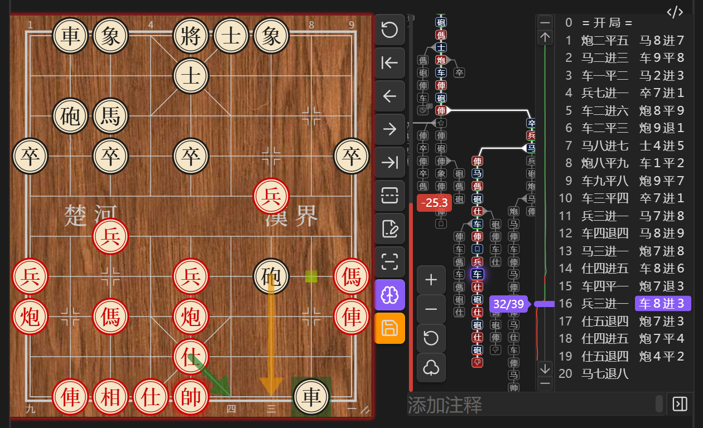
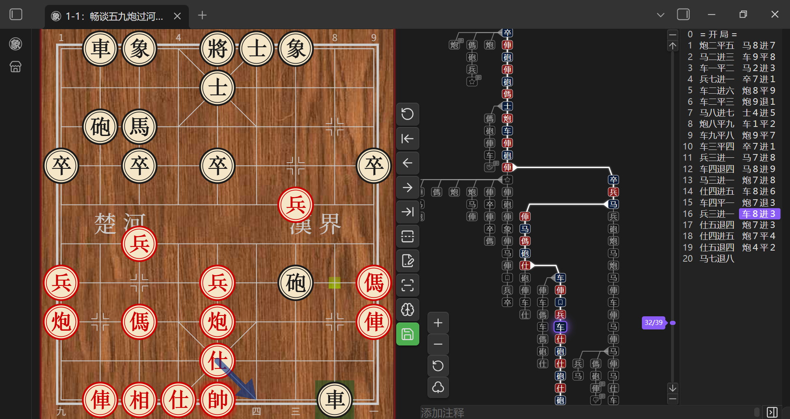
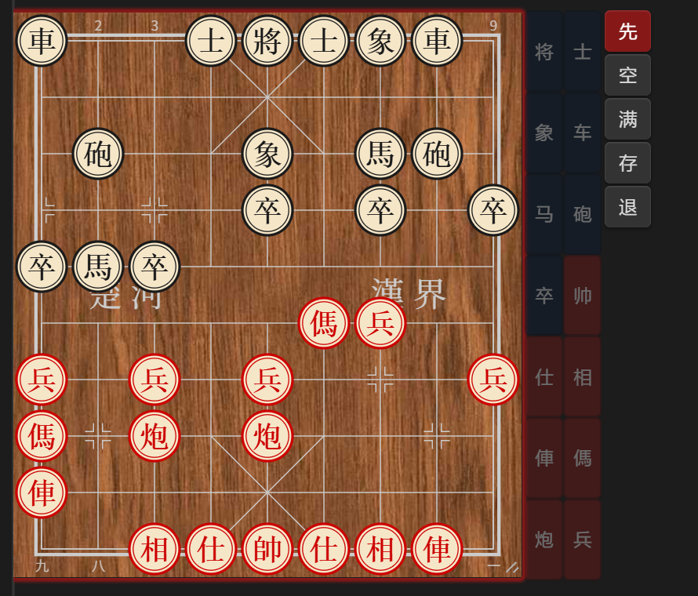
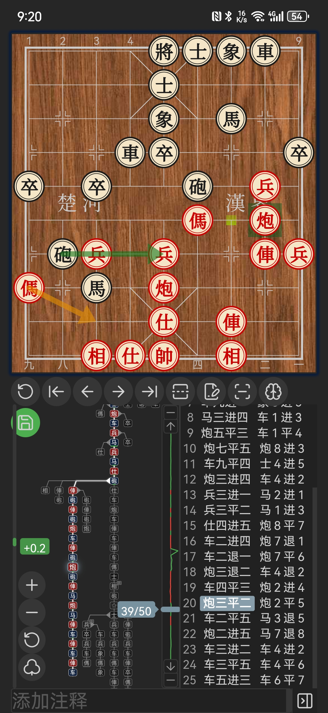
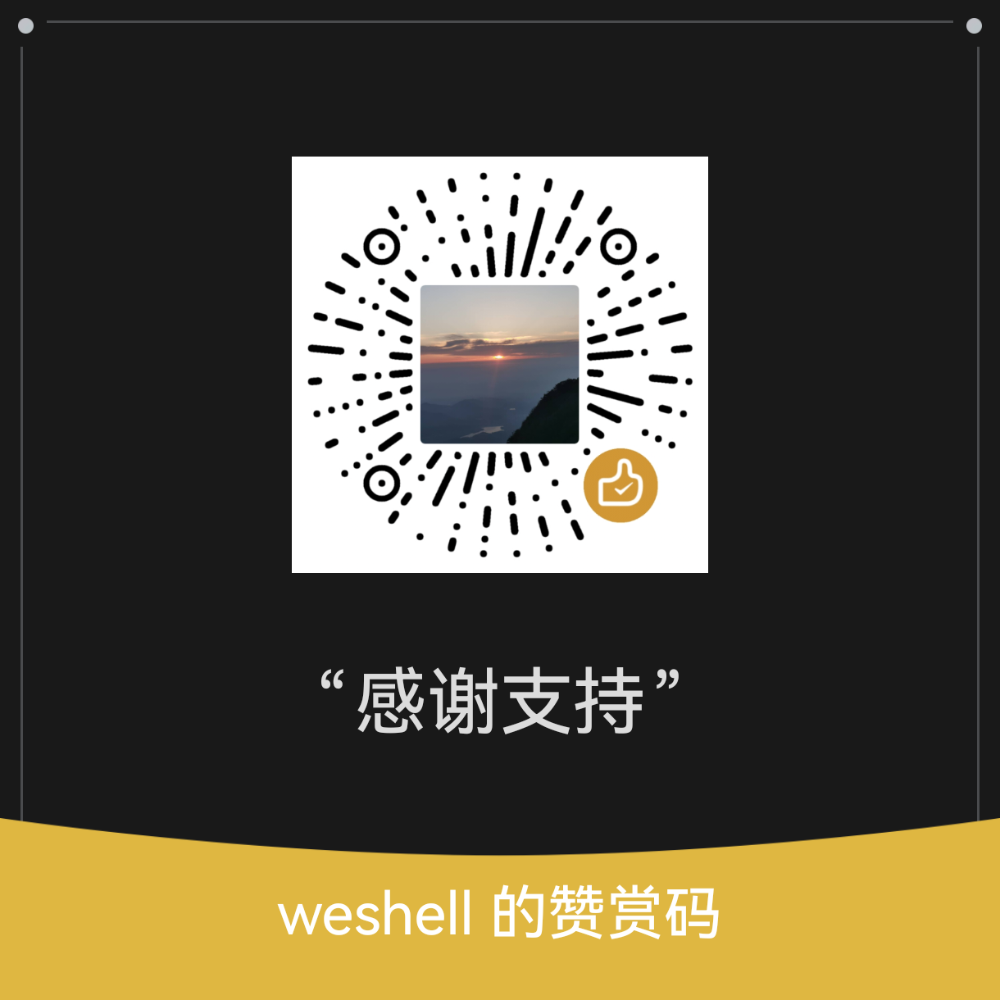

# Chinese Chess


[](./LICENSE)
[](https://discord.gg/FQhgku2Cr)
[](https://paypal.com/paypalme/weshell1988)
[](https://afdian.com/a/weshell)

> Play, explore and analyze Chinese chess (xiangqi) right inside your Obsidian notes — full PGN support, interactive boards, variation trees and a built-in Pikafish engine (WASM).



English | [中文文档](./README.zh.md)

## Getting Started

There are three ways to use the plugin — all of them end up on the same interactive board.

### Open a PGN file

Any `.pgn` file opens in a dedicated chess view: browse the variation tree, edit moves and comments, run engine analysis, and save back to the file with one click. Multiple games in one file are managed via the game navigation bar — switch, add, reorder, or delete them — and the ribbon button creates a new PGN file in your configured folder, opening the rename dialog so you can name it right away.



### Embed a game in a note

Write moves in a `xiangqi` code block — the position renders as an interactive board with the full variation tree:

````markdown
```xiangqi
1. H2-E2 H9-G7
2. H0-G2 I9-H9
3. I0-H0 B9-C7
```
````

Optional parameters: `protected`/`p` (disable Save), `rotated`/`r` (flip board, Red on bottom). FEN is optional — with quotes or without:

````markdown
```xiangqi
r:true
[FEN "2bk1a3/5n3/3Pb4/R7p/2p6/C3p2N1/PR2c3P/1nr1B1C2/4A4/1rB1KA3 w"]
1. G2-G9 F9-E8
2. D7-D8 D9-E9
```
````

Moves can be numbered together, unnumbered, or written one by one.

### Set up a position

A `fen` code block opens a visual position editor — drag or click to place pieces, set the side to move, then save. It becomes a playable `xiangqi` code block containing the FEN.



## Feature Tour

### Variation Tree & Keyboard Navigation

Every branch is visualized as a tree graph — click any node to jump to that position, and switch between icon and text label modes. The current branch's arrows render at full opacity while sibling branches fade to 50%, so the line you're on stands out. Keyboard shortcuts keep your hands on the board:

| Shortcut                                | Action                                                                                             |
| --------------------------------------- | -------------------------------------------------------------------------------------------------- |
| `Ctrl+↑` / `Ctrl+↓`                     | Jump to the previous / next fork (branching point) along the line                                  |
| `Ctrl+←` / `Ctrl+→`                     | Switch the displayed branch at the first unfolded fork below the current node (wraps)              |
| `Ctrl+Alt+Shift+←` / `Ctrl+Alt+Shift+→` | Cycle through every visible variation below the current node (wraps)                               |
| `Alt+←` / `Alt+→`                       | Cycle through every branch's node at the current ply (short or folded branches are skipped; wraps) |
| `Alt+Shift+←` / `Alt+Shift+→`           | Jump between the ends of all visible branches (wraps)                                              |
| `Ctrl+Shift+←` / `Ctrl+Shift+→`         | Cycle between the first steps of all visible branches (wraps)                                      |
| `↑` / `↓` / `←` / `→` (PGN view)        | Step one move back / forward; jump to game start / end                                             |

Branch navigation works in both the PGN file view and `xiangqi` code blocks (in code blocks, hover the block and keep focus out of text editors). On macOS, `Ctrl+↑`/`Ctrl+↓` may conflict with Mission Control. All branch-switching shortcuts skip branches hidden by folding. All PGN view navigation actions are also available as commands in the Command Palette — without preset hotkeys, to avoid conflicts with core and other plugins; assign your own in Settings → Hotkeys if you want global bindings. All PGN view shortcuts are built into the view and only active while it is focused. Code block shortcuts are built-in and hover-gated.

### Engine Analysis

Built-in Pikafish (WASM) — no external installation needed.

- **Single / batch / auto analysis**: analyze one position, every node, or automatically as you play
- **Best-move & ponder arrows**: green for best move, yellow for the ponder move
- **Eval bar**: live evaluation beside the board (green = red advantage, red = black advantage)
- **Eval trend chart & node color bars**: see the whole game's evaluation at a glance
- **Persistence**: evaluations are stored as `%e:` comments in PGN
- **Engine play**: play against the engine with configurable depth (1–30) and skill level (0–20)

### Board & Pieces

- **7 board styles**: Auto, Light, Dark, Parchment, Green, Wood, Bamboo — with a swatch picker in the board menu
- **Adjustable size**: board and piece display scale (0–100%)
- **Board markers**: draw arrows and highlights on the board
- **Feedback options**: last-move highlight, next-move hints, other variations, turn border, move sounds, spoken moves (desktop)
- **Board editor**: **Edit board** turns any game into a position editor; existing moves are discarded on save

### Move List

Grid-aligned move columns with Chinese (炮二平五) or coordinate (h2e6) notation, adjustable font size, and per-move marks — eval bar, annotation badge, glyph and comment underline — each independently toggleable.

### Export & Share

- **PNG snapshot**: export the current board as a high-resolution image with your board style
- **Animated GIF**: export the mainline, the current branch, or every game in the file as a compact GIF with a configurable frame interval (0.1–10 s)
- **Save-as dialog**: pick the destination before saving — fuzzy folder picker (`/` = vault root) plus filename, with an overwrite confirmation; missing folders are created automatically
- **Default export folder**: a settings field that prefills the save-as dialog (unset falls back to Obsidian's attachment-folder setting)

### Mobile

The responsive layout automatically switches between single-column (portrait) and double-column (landscape) views. For best results, combine it with a fullscreen plugin (e.g. [obsidian-full-screen-cross-platform-plugin](https://github.com/donkeypacific/obsidian-full-screen-cross-platform-plugin)) and tune the top/bottom board margins in settings.



## Settings Overview

All options live in **Settings → Xiangqi**, grouped as follows:

| Group            | What you can configure                                                          |
| ---------------- | ------------------------------------------------------------------------------- |
| Board Appearance | Board style, board/piece size, coordinate labels                                |
| Game Hints       | Last move, next moves, other variations, turn border, sounds, speech, auto jump |
| Move List        | Visibility, text size, notation, per-move marks                                 |
| Board Margins    | Top/bottom margin (0–100 px) for fullscreen layouts                             |
| Code Block Names | Aliases for `xiangqi`/`tree` blocks, FEN save target                            |
| Engine Analysis  | Depth, skill level, arrows, engine/board annotations                            |
| Save             | Include eval on save, eval prompt, default export folder                        |
| PGN File View    | Enable/disable the view, custom file extensions, new PGN file location          |

Code block names, file extensions, and custom file types take effect after restarting the plugin or Obsidian.

## Installation

This plugin is available on the official Obsidian community plugin marketplace:

1. Open **Settings → Community plugins** (Restricted mode off)
2. Click **Browse** and search for **"Chinese chess"** or **"xiangqi"**
3. Click **Install**, then **Enable**

## Build

```bash
git clone https://github.com/west-shell/obsidian-xiangqi.git
cd obsidian-xiangqi
npm install
npm run build        # Minified production build (for release)
npm run build:debug  # Unminified production build (with sourcemaps)
```

`xiangqi.js` and `xiangqiground` are installed from npm.

## Credits & License

- Rules engine: [xiangqi.js](https://github.com/west-shell/xiangqi.js)
- Board rendering: [xiangqiground](https://github.com/west-shell/xiangqiground)
- Engine: [Pikafish](https://github.com/official-pikafish/Pikafish) (WASM)
- i18n: English and Chinese UI

Released under [GPL-3.0](./LICENSE).

## Support the Project

[](https://paypal.com/paypalme/weshell1988)
[](https://afdian.com/a/weshell)

If you like this project, check out my [Bilibili](https://space.bilibili.com/156446344) page — likes, coins and feedback are greatly appreciated.


